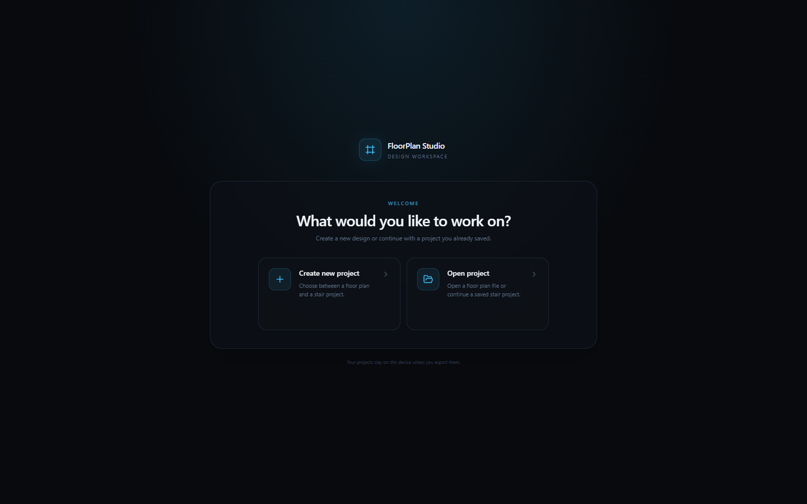
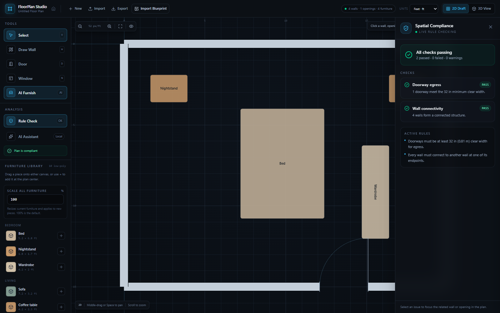
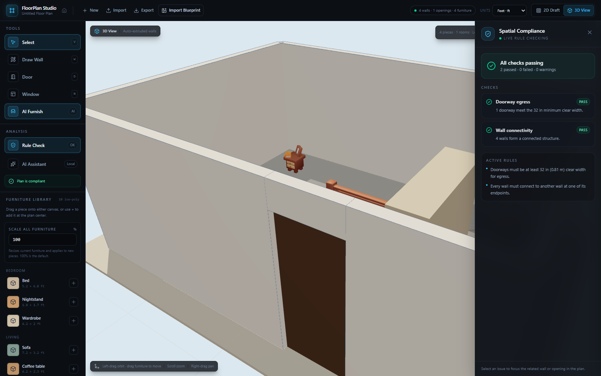
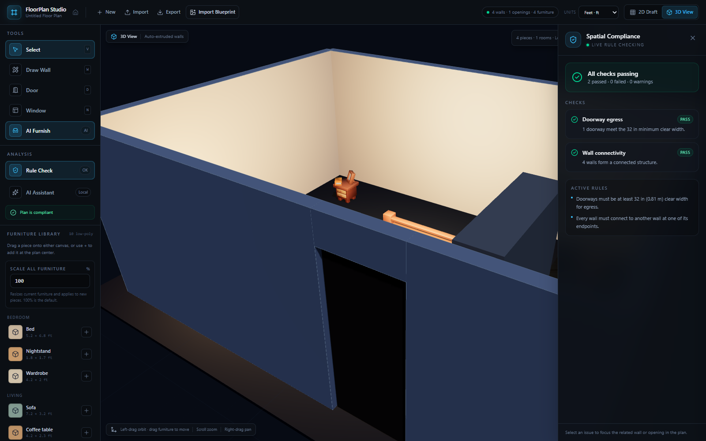
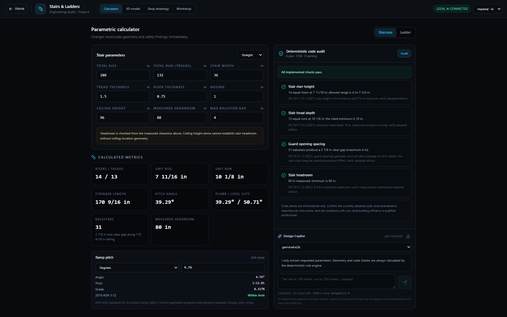
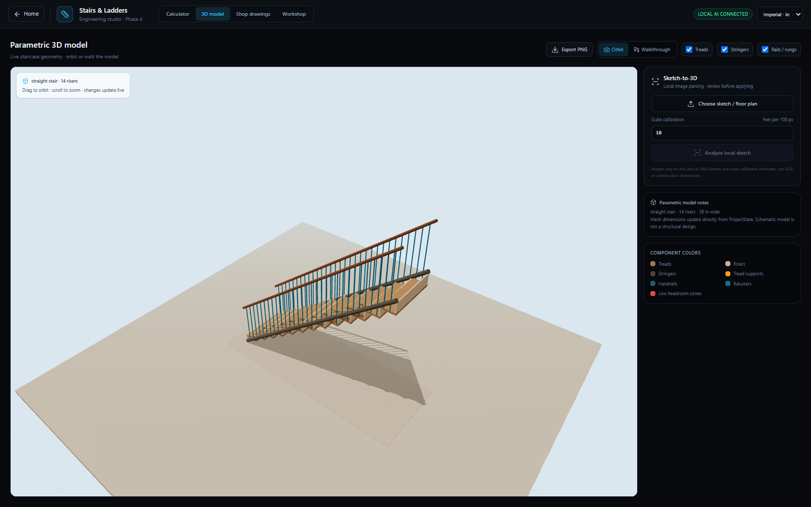
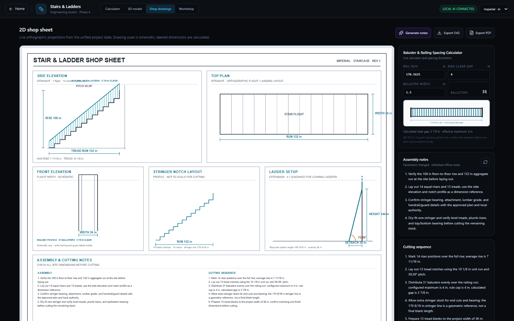

# FloorPlan Studio

[](https://github.com/ezzakyabdellah/floorplan-studio/actions/workflows/ci-quality-gate.yml)
[](https://github.com/ezzakyabdellah/floorplan-studio/actions/workflows/codeql.yml)
[](#)

> A cross-platform desktop studio for 2D drafting, 3D visualization, and AI-assisted floor-plan and stair design.

## Screenshots

| Start screen | 2D drafting workspace |
| --- | --- |
|  |  |

| 3D view — sunny | 3D view — night |
| --- | --- |
|  |  |

| Stair & ladder studio | Stair 3D model | Shop drawings |
| --- | --- | --- |
|  |  |  |

See [WIKI.md](WIKI.md) for a guided tour of these screens.

## Overview

FloorPlan Studio is a [Tauri 2](https://tauri.app/) desktop application built with
React 19, TypeScript, Tailwind CSS, Three.js (React Three Fiber), and a Rust
backend. It combines a drafting canvas, an extruded 3D viewport, deterministic
engineering calculations, and an AI copilot that can run against Google Gemini or
a fully local Ollama model.

The app is local-first: projects, preferences, and AI activity logs stay on the
user's machine. The optional Gemini key is read from a per-user configuration
file and is never compiled into the installer.

## Key features

- **2D drafting canvas** — draw and edit walls, doors, and windows with live
  dimension feedback, snapping, and selection.
- **3D visualization** — automatic wall extrusion with door/window openings,
  furniture models, orbit controls, and sunny/night scene environments.
- **AI copilot** — ask questions, audit a plan, generate a floor plan, or furnish
  a room. Gemini and local Ollama share the same prompts, validation, streaming,
  and structured-JSON handling.
- **On-device vision** — ONNX Runtime Web segmentation converts raster floor plans
  into wall/door/window geometry without uploading the image.
- **Stair & ladder studio** — rise/run, headroom, baluster spacing, railing, and
  ladder calculations with SVG/PDF shop-sheet export.
- **Engineering tooling** — building-code audit, safety inspection reports, cut
  optimizer, bill of materials, and CAD/vector export.
- **Local project library** — revisions and project state persist in the browser
  storage layer; scene files can be exported and re-imported as JSON.

## Security & architecture

### Tauri capability least-privilege

The single `default` capability (`src-tauri/capabilities/default.json`) is scoped
to the `main` window and lists only the permissions the app uses:

- `core:default` for core window/path APIs.
- `dialog:allow-open` and `dialog:allow-save` (no message/confirm dialogs).
- `opener:allow-reveal-item-in-dir` (no arbitrary URL/path opening).
- `http:default` restricted to `http://localhost:11434/**` and
  `http://127.0.0.1:11434/**` for Ollama.
- `fs:default` plus app-local-data read/write, and user file read/write scoped to
  `$HOME`, `$DESKTOP`, `$DOCUMENT`, and `$DOWNLOAD`.
- Explicit `deny` scopes for sensitive locations: `.ssh`, `.aws`, `.gnupg`,
  `.kube`, `.docker`, `.azure`, `.gcloud`, `.config`, `.env`, `.netrc`, `.npmrc`,
  and OS keyring directories.

`app.security.capabilities` is set explicitly to `["default"]`.

### Content Security Policy

`src-tauri/tauri.conf.json` defines a strict CSP:

- `script-src 'self' 'wasm-unsafe-eval'` (WebAssembly for ONNX Runtime).
- `style-src 'self' 'unsafe-inline'` and `img-src`/`font-src` limited to `self`,
  `asset:`, `data:`, and `blob:`.
- `connect-src` restricted to the Tauri IPC channel, the bundled asset origin,
  localhost Ollama, and `generativelanguage.googleapis.com`.
- `object-src 'none'`, `base-uri 'self'`, and `form-action 'none'`.
- `withGlobalTauri` is disabled and `dangerousDisableAssetCspModification` is
  left at its secure default (`false`).

### Rust IPC and path handling

The Rust surface is intentionally tiny. The only custom command is `get_app_env`,
which resolves the configuration file through Tauri's `app_config_dir()` rather
than a caller-supplied path. There is no shell/process execution, no arbitrary
path joining, and no AI tool that writes to the filesystem. All user file access
goes through the Tauri `fs` plugin, whose capability scopes and deny lists are
enforced in Rust before the WebView can read or write a path.

### Secret handling

`GEMINI_API_KEY` is stored in a per-user `.env` file under the OS application
config directory (created with `0600` permissions on Unix) and is never bundled
into the installer. `.env` and `.env.*` are git-ignored; only `.env.example` is
tracked. The key is read into the WebView at runtime so the official
`@google/genai` SDK can call Gemini directly; this trade-off is documented in
`docs/gemini-integration.md`. Moving the API call into the Rust backend with an
OS credential store (`keyring`) is a natural follow-up hardening step.

### XSS defense

AI responses are rendered as plain text (`whitespace-pre-wrap`), not as HTML or
Markdown. The only `dangerouslySetInnerHTML` usage is the internally generated
shop-sheet SVG, whose text is XML-escaped before rendering.

### Automated CI security gates

[`.github/workflows/ci-quality-gate.yml`](.github/workflows/ci-quality-gate.yml)
runs on every push and pull request to `main`:

1. **Gitleaks** scans the full Git history (`fetch-depth: 0`).
2. **Rust** — `cargo fmt --check`, `cargo clippy --all-targets -- -D warnings`,
   and `cargo test`.
3. **Vulnerabilities** — `cargo audit` and Trivy filesystem scanning for
   HIGH/CRITICAL issues.
4. **Frontend** — clean `npm ci`, `tsc --noEmit`, `npm test`, and a production
   build.

[CodeQL](.github/workflows/codeql.yml) analysis runs on the same triggers plus a
weekly schedule.

## Prerequisites

| Tool | Version | Notes |
| --- | --- | --- |
| [Rust](https://rustup.rs/) | stable | Required for the Tauri backend |
| [Node.js](https://nodejs.org/) + npm | 20+ | Frontend build and tests |
| [Git LFS](https://git-lfs.com/) | 3.x | Fetches the bundled ONNX model |
| [Ollama](https://ollama.com/) | optional | Local AI provider at `http://localhost:11434` |

**Linux (Debian/Ubuntu)** also needs the WebKit/GTK development packages:

```bash
sudo apt install libwebkit2gtk-4.1-0 libgtk-3-0 libayatana-appindicator3-1 \
  librsvg2-dev patchelf libxdo-dev libssl-dev libglib2.0-dev build-essential \
  curl wget file
```

**macOS** requires the Xcode Command Line Tools (`xcode-select --install`).
**Windows** requires the WebView2 Runtime (preinstalled on Windows 11) and the
MSVC build tools.

## Local setup

```bash
git lfs install
git clone https://github.com/ezzakyabdellah/floorplan-studio.git
cd floorplan-studio
npm ci
npm run tauri dev
```

To produce installers for all supported platforms:

```bash
npm run tauri build
```

## Configuration

On first launch the app creates a per-user config file and shows a warning banner
if `GEMINI_API_KEY` is missing:

| OS | Config file |
| --- | --- |
| Windows | `%APPDATA%\com.floorplan.studio\.env` |
| macOS | `~/Library/Application Support/com.floorplan.studio/.env` |
| Linux | `~/.config/com.floorplan.studio/.env` |

```env
GEMINI_API_KEY=your-google-ai-studio-api-key
GEMINI_MODEL=gemini-4-hydrogen
GEMINI_FAST_MODEL=gemini-3.5-flash-lite
```

Create a free key at [Google AI Studio](https://aistudio.google.com/apikey). For
browser-only development you can set `VITE_GEMINI_API_KEY` instead; never ship a
build created with an embedded key. Without a key, Auto mode falls back to a
local Ollama model.

## Testing

```bash
npm test                # frontend unit tests
npm run build           # typecheck + production build
cd src-tauri && cargo test
cd src-tauri && cargo clippy --all-targets -- -D warnings
```

Optional ONNX model tests and benchmarks require the model files described in
[`docs/model-benchmark.md`](docs/model-benchmark.md):

```bash
npm run test:onnx
```

## Project structure

```
src/            React + TypeScript frontend (canvas, engineering, services)
src-tauri/      Rust/Tauri backend, capabilities, and bundle config
public/models/  ONNX segmentation model (Git LFS) and furniture assets
scripts/        Python scripts to export and evaluate ONNX models
docs/           Architecture and pipeline notes
```

## License

[MIT](LICENSE)
