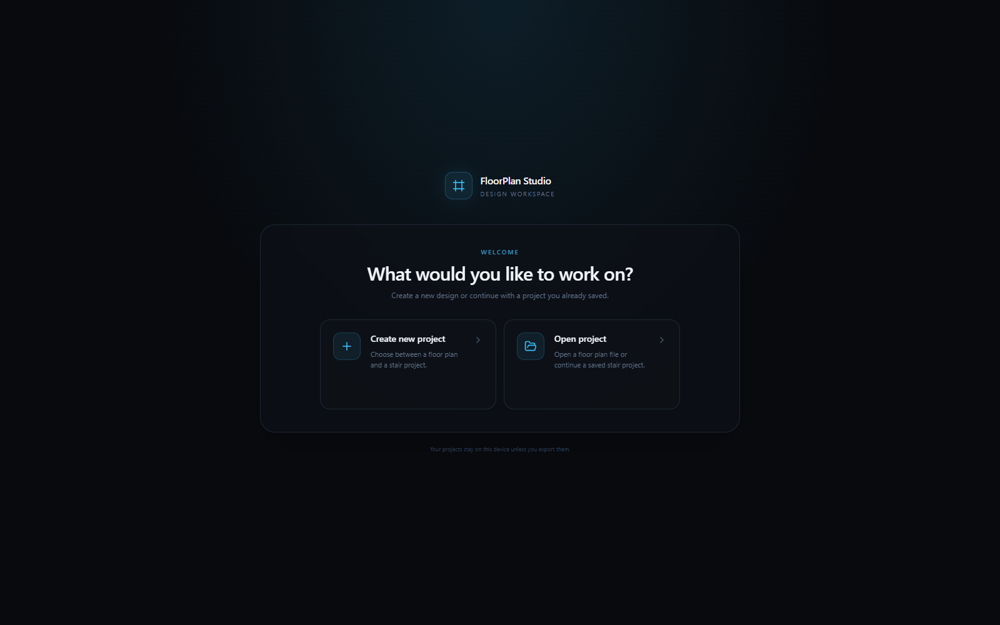
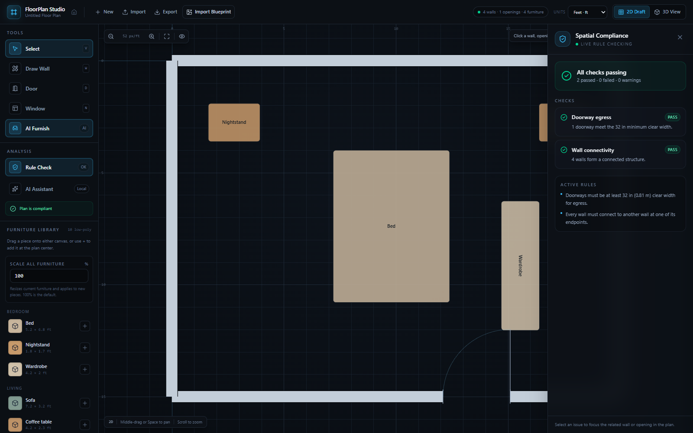
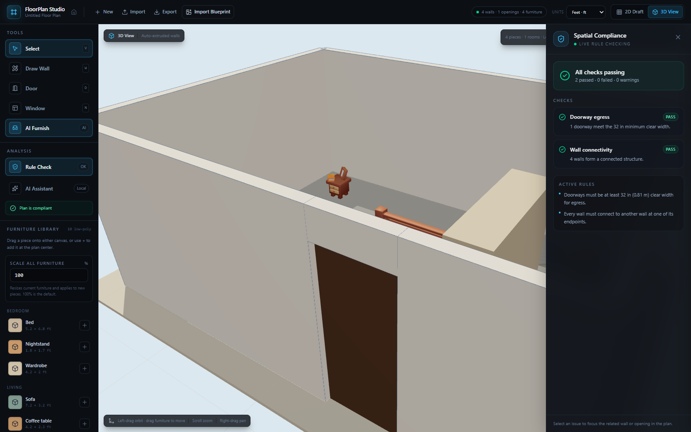
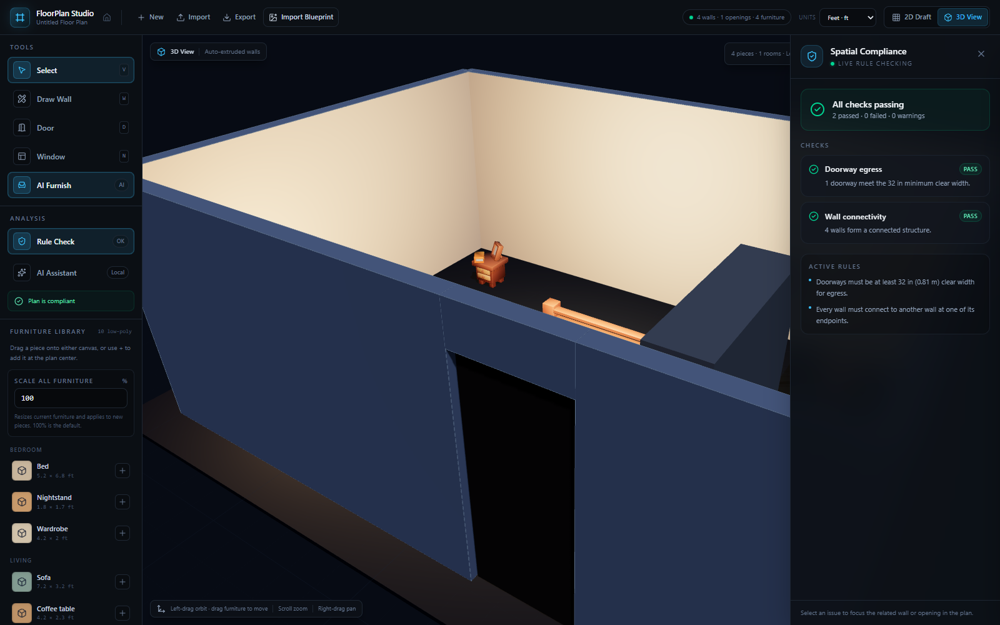
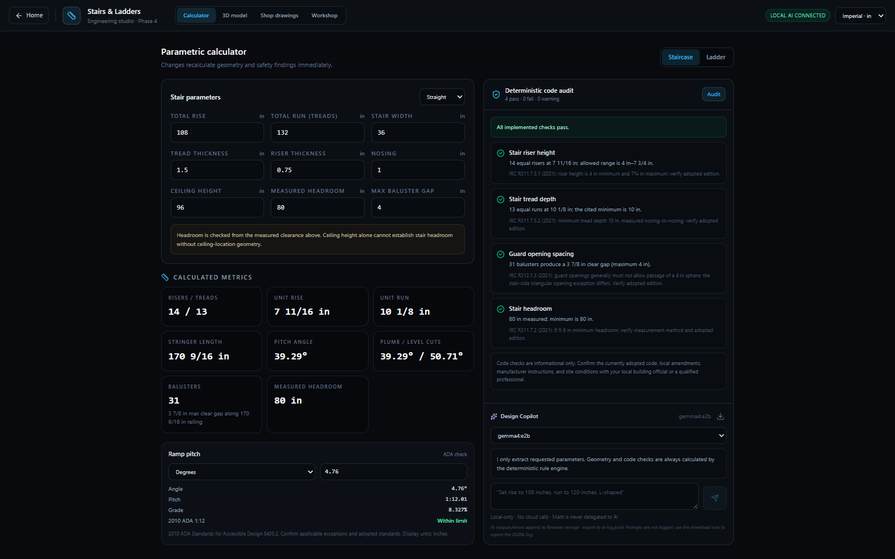
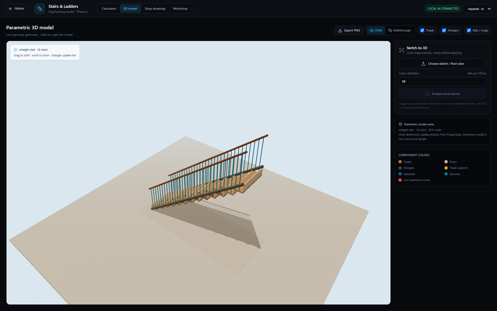
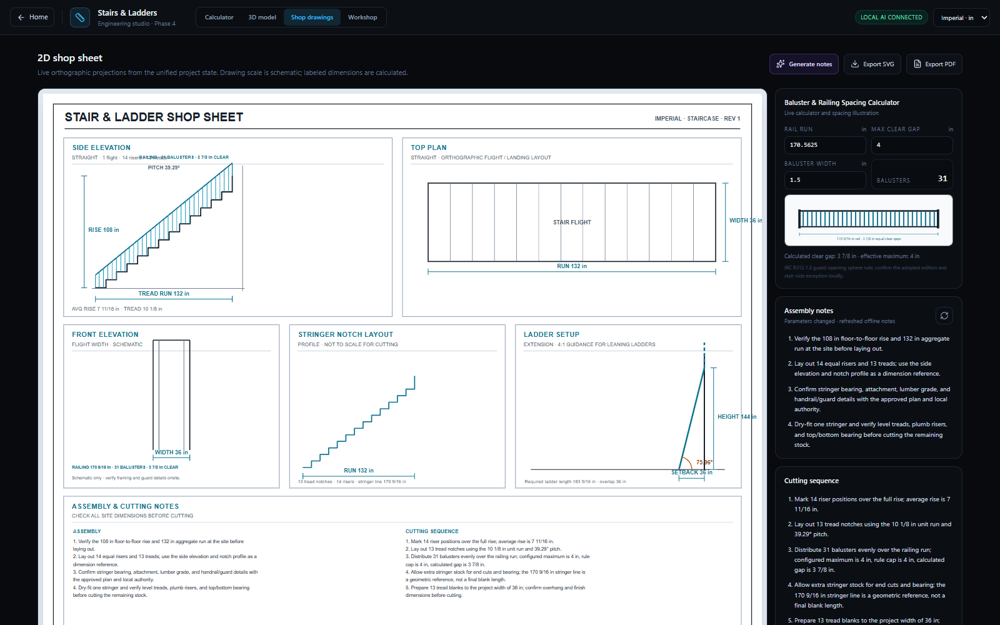

# FloorPlan Studio Wiki

Welcome to the FloorPlan Studio wiki. This page is a quick visual guide to the
app's screens and workflows. For installation, security architecture, and CI
details, see the [README](README.md).

## Contents

- [Start screen](#start-screen)
- [Floor plan workspace](#floor-plan-workspace)
- [2D drafting](#2d-drafting)
- [3D visualization](#3d-visualization)
- [AI furnishing and assistance](#ai-furnishing-and-assistance)
- [Stair & ladder studio](#stair--ladder-studio)
- [Projects and files](#projects-and-files)
- [Further reading](#further-reading)

## Start screen

The start screen lets you:

- **Create new project** — choose a floor plan or a stair project.
- **Open project** — load a saved `.json` scene or reopen a stair project from
  the local library.

A configuration banner appears on first launch when `GEMINI_API_KEY` is missing.
Gemini features stay disabled until the key is added; local Ollama and
geometry-based tools keep working.

## Floor plan workspace

A new floor plan opens with a simple 20 × 15 ft room, one doorway, live rule
checking, and the furniture library. The workspace is split into:

- **Top bar** — project name, units, import/export, and 2D/3D switching.
- **Left sidebar** — drafting tools, analysis panels, furniture library, and a
  selection inspector.
- **Center canvas** — the interactive 2D plan or 3D scene.
- **Right panel** — live spatial compliance results.

## 2D drafting

Use the left toolbar or keyboard shortcuts:

| Shortcut | Tool | Action |
| --- | --- | --- |
| `V` | Select | Select and drag walls, openings, or furniture |
| `W` | Draw Wall | Click two points to create a wall |
| `D` | Door | Click a wall to insert a doorway |
| `N` | Window | Click a wall to insert a window |
| `R` | Rule Check | Show or hide live compliance results |
| `A` | AI Assistant | Open the copilot panel |

Selected walls, openings, and furniture can be edited precisely in the
inspector. Middle-drag or hold `Space` to pan; scroll to zoom.

## 3D visualization

The 3D view extrudes walls automatically and cuts openings for doors and
windows. Furniture, shadows, and low-poly models update as you edit the 2D plan.

Use the **Sunny** / **Night** toggle in the 3D toolbar to switch scene lighting.
Orbit with the mouse, zoom with the wheel, and drag furniture directly in either
view to reposition it.

## AI furnishing and assistance

- **AI Furnish** generates a furniture layout. With Gemini or Ollama available,
  it uses AI suggestions; otherwise it falls back to a deterministic,
  geometry-based room guess.
- **AI Assistant** can answer plan questions, audit the design, generate a plan,
  or suggest furniture. Responses are shown as plain text.
- **Import Blueprint** uses on-device ONNX segmentation to turn a raster plan
  into wall, door, and window geometry. The image is not uploaded.

Provider choice and model details are documented in
[`docs/gemini-integration.md`](docs/gemini-integration.md).

The **Local AI runtime** card in the sidebar reports whether Ollama is running
and links to its installer when it is not. The ONNX vision model is bundled with
the app; Ollama is a separate optional runtime for chat and text generation.

## Stair & ladder studio

The stair studio provides parametric rise/run design, headroom checks, baluster
spacing, 3D previews, and SVG/PDF shop-sheet export. Use the tabs in the studio
to move between design inputs, the 3D model, the workshop drawings, and
production tools. The **3D model** tab renders the live staircase geometry as an
orbitable or walkthrough model, with toggles for treads, stringers, and
rails/rungs. The **Shop drawings** tab produces a live orthographic sheet with
side elevation, top plan, front elevation, stringer notch layout, and computed
dimensions; it can be exported as SVG or PDF.

## Projects and files

- Floor plans are saved as JSON scene files with **Export** and reopened with
  **Import**.
- Stair projects are stored in a local project library and listed on the start
  screen.
- Preferences, furniture scale, display units, and scene lighting persist in
  browser storage.
- The ONNX segmentation model is fetched through Git LFS; run `git lfs install`
  before cloning.

## Further reading

- [README](README.md) — setup, configuration, security, and testing
- [Extraction pipeline](docs/extraction-pipeline.md)
- [ONNX pipeline walkthrough](docs/onnx-pipeline-walkthrough.md)
- [Model benchmark](docs/model-benchmark.md)
- [Gemini integration](docs/gemini-integration.md)
